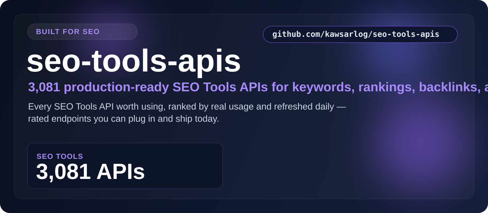

  

  <a href="#at-a-glance"><b>At a Glance</b></a> &nbsp;•&nbsp;
  <a href="#the-categories"><b>Categories</b></a> &nbsp;•&nbsp;
  <a href="#start-here"><b>Start Here</b></a> &nbsp;•&nbsp;
  <a href="#built-for"><b>Built For</b></a> &nbsp;•&nbsp;
  <a href="#why-this-repo"><b>Why This Repo</b></a>

## At a Glance

> **3,296** production-ready SEO Tools APIs.

A focused, always-fresh index of SEO Tools APIs for keywords, rankings, backlinks, and SERP data. Every entry is rated, shows real user counts, and is refreshed daily — so you find the right one fast.

| Metric | Value |
|--------|-------|
| **Total APIs** | **3,296** |
| **Categories** | 1 |
| **Last updated** | 2026-07-25 |
| **Update cadence** | Daily, automated |

## The Categories

<table>
  <tr>
    <td width="100%" valign="top">
      <h3>SEO Tools</h3>
      
<strong>3,296 APIs</strong>

      
Keywords, rankings, backlinks, and SERP data for search visibility.

      
<a href="./SEO_tools/"><strong>Open SEO Tools &rarr;</strong></a>

    </td>
  </tr>
</table>

## Start Here

1. Pick the category that matches what you're building.
2. Open its folder and scan the API names, ratings, and user counts.
3. Click through to the provider page for docs, pricing, and setup.
4. Shortlist in minutes — no digging through unrelated categories.

## Explore the Stack

<strong>SEO Tools — 3,296 APIs</strong>

Keywords, rankings, backlinks, and SERP data for search visibility.

[Browse SEO Tools APIs &rarr;](./SEO_tools/)

## Built For

<table>
  <tr>
    <td width="25%" align="center"><strong>SEO platforms</strong></td>
    <td width="25%" align="center"><strong>Rank tracking</strong></td>
    <td width="25%" align="center"><strong>Keyword research</strong></td>
    <td width="25%" align="center"><strong>Backlink audits</strong></td>
  </tr>
  <tr>
    <td width="25%" align="center"><strong>SERP scraping</strong></td>
    <td width="25%" align="center"><strong>Content tools</strong></td>
    <td width="25%" align="center"><strong>Agencies</strong></td>
    <td width="25%" align="center"><strong>Marketers</strong></td>
  </tr>
</table>

## Why This Repo

- **Opinionated, not exhaustive.** Only the categories that matter here — no clutter.
- **Always fresh.** A scheduled job re-scrapes the source and updates the counts daily.
- **Fast to scan.** Ratings and real usage numbers surface the APIs worth your time.
- **Consistent.** Every category follows the same clean, sortable layout.

---

**3,296 APIs** across **1 categories** — updated 2026-07-25
 If this saved you time, a star helps others find it.

